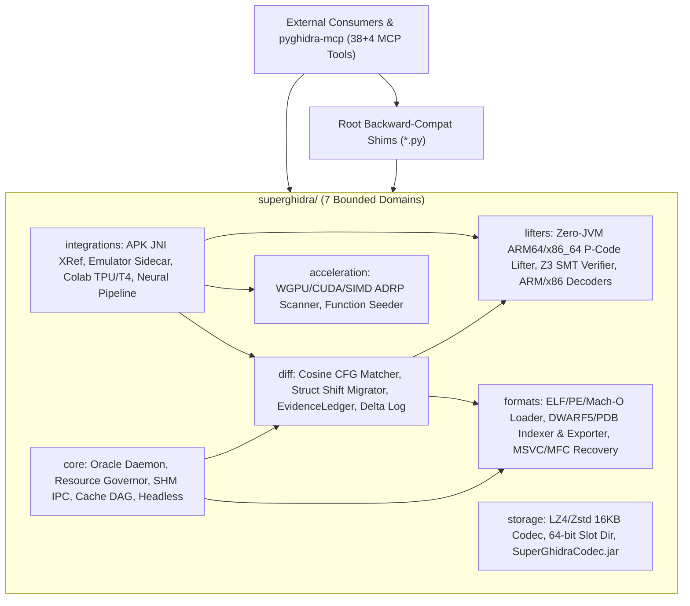

# SuperGhidra System Architecture & Domain Map (`ARCHITECTURE.md`)

> **Progressive Discovery Entry Point (< 1,500 Tokens):** For AI agent task routing and `code-review-graph` MCP instructions, see [`AGENTS.md`](AGENTS.md). For full empirical benchmarks and roadmap, see [`README.md`](README.md) and [`PLAN.md`](PLAN.md).

## 1. Layered Domain Architecture

---

## 2. Bounded Domains Summary

| Domain | Canonical Path | Core Responsibilities | Subsystem Index |
| :--- | :--- | :--- | :--- |
| **`core`** | `superghidra/core/` | Persistent TCP daemon (`127.0.0.1:5073`), L2 SQLite cache, `eco`/`balanced`/`turbo`/`auto` Resource Governor, zero-copy SHM IPC, 1-hop Cache DAG, headless tuner, C++ PGO builder, Evidence Ledger re-export. | [`superghidra/core/README.md`](superghidra/core/README.md) |
| **`storage`** | `superghidra/storage/` | 16 KB block compression (LZ4 in-flight, Zstd L3 snapshot), 20-byte 64-bit slot directory, Python/Java `.sgdb` interop, `SuperGhidraCodec.jar` packager. | [`superghidra/storage/README.md`](superghidra/storage/README.md) |
| **`acceleration`** | `superghidra/acceleration/` | WGPU / PyTorch CUDA / NumPy SIMD ARM64 `ADRP+ADD/LDR` reference scanner and parallel function prologue/BL target seeder. | [`superghidra/acceleration/README.md`](superghidra/acceleration/README.md) |
| **`diff`** | `superghidra/diff/` | 32-dim CFG cosine-similarity binary matcher, cross-version struct field displacement shift migrator, `ReconstructionObligationLedger` formal proof gate, SHA-256 `.ghidra-delta.jsonl` log. | [`superghidra/diff/README.md`](superghidra/diff/README.md) |
| **`lifters`** | `superghidra/lifters/` | Zero-JVM ARM64 & x86_64 P-Code IR lifter, GNN/TPU adjacency tensor builder, Z3 SMT bit-exact equivalence verifier, ARM32/Thumb-2 and table-driven x86/AVX-512 decoders. | [`superghidra/lifters/README.md`](superghidra/lifters/README.md) |
| **`formats`** | `superghidra/formats/` | Unified ELF/PE/Mach-O loader, off-heap DWARF 5/PDB SQLite deduplicator, standalone DWARF 5/PDB/Breakpad/Map synthesis, MSVC RTTI + MFC `CRuntimeClass` recovery, `Serialize()` tracer, `CArchive` stream decoder. | [`superghidra/formats/README.md`](superghidra/formats/README.md) |
| **`integrations`** | `superghidra/integrations/` | Android APK DEX + NDK `RegisterNatives` cross-referencer, live Android emulator memory sidecar with `EmulatorFleetGuard`, Colab TPU v5e/T4 orchestrator, 2-phase Skeleton-to-Skin neural decompiler pipeline. | [`superghidra/integrations/README.md`](superghidra/integrations/README.md) |

---

## 3. Decision Matrix for Targeted Inspection

- **If your task is modifying Daemon/Governor/IPC/Headless:** Read [`superghidra/core/README.md`](superghidra/core/README.md) -> Run `python -m pytest tests/core -q`.
- **If your task is modifying Block Compression or Java Extension:** Read [`superghidra/storage/README.md`](superghidra/storage/README.md) -> Run `python -m pytest tests/storage -q`.
- **If your task is modifying GPU Shaders or SIMD Scanners:** Read [`superghidra/acceleration/README.md`](superghidra/acceleration/README.md) -> Run `python -m pytest tests/acceleration -q`.
- **If your task is modifying Binary Diffing, Struct Shifts, or Evidence Proofs:** Read [`superghidra/diff/README.md`](superghidra/diff/README.md) -> Run `python -m pytest tests/diff -q`.
- **If your task is modifying P-Code Lifting, Z3 SMT Verification, or ISA Decoding:** Read [`superghidra/lifters/README.md`](superghidra/lifters/README.md) -> Run `python -m pytest tests/lifters -q`.
- **If your task is modifying Binary Parsing, DWARF/PDB, or MSVC/MFC CArchive:** Read [`superghidra/formats/README.md`](superghidra/formats/README.md) -> Run `python -m pytest tests/formats -q`.
- **If your task is modifying APK JNI, Emulator Sidecar, Colab, or Neural Skinning:** Read [`superghidra/integrations/README.md`](superghidra/integrations/README.md) -> Run `python -m pytest tests/integrations -q`.
