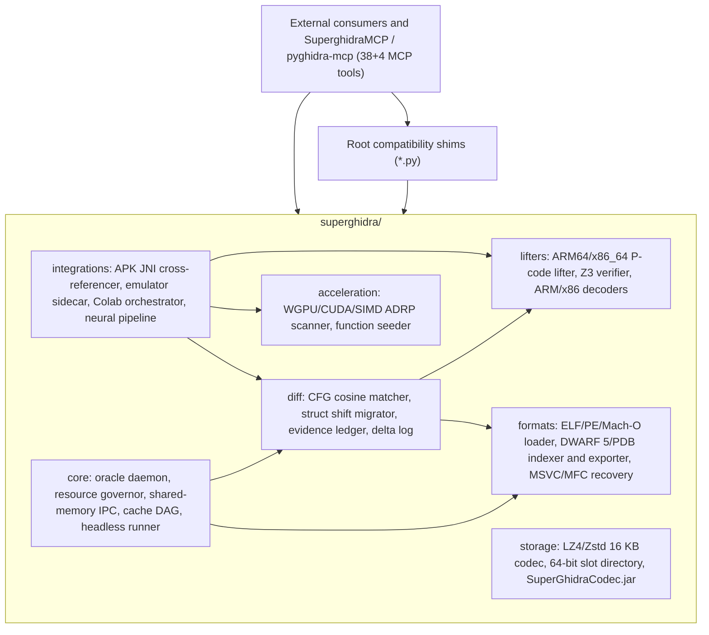

# SuperGhidra Architecture

SuperGhidra is one Python package, `superghidra`, split into seven domains. This page shows how they depend on each other and where to look for a given task. Benchmarks and results are in [`README.md`](README.md), the roadmap is in [`PLAN.md`](PLAN.md), and the rules for AI agents working in the repo are in [`AGENTS.md`](AGENTS.md).

## How the domains connect

The root-level `*.py` files exist so that `pyghidra-mcp` and other outside callers can keep writing `import binary_loader`. Each one is a thin alias for its module under `superghidra/<domain>/`. Keep the alias when you move or rename a module.

## What each domain does

| Domain | Path | Responsibilities | Docs |
| :--- | :--- | :--- | :--- |
| `core` | `superghidra/core/` | Background daemon on `127.0.0.1:5073` with an SQLite cache. The `eco`, `balanced`, `turbo` and `auto` resource governor. Shared-memory IPC. A cache invalidation DAG that drops only the entries a change affects. Headless tuning and a PGO build script for the native decompiler. | [`core/README.md`](superghidra/core/README.md) |
| `storage` | `superghidra/storage/` | Compression of 16 KB buffer pages (LZ4 for working data, Zstd level 3 for snapshots), a 20-byte 64-bit slot directory, Python and Java `.sgdb` interop, and the `SuperGhidraCodec.jar` packager. | [`storage/README.md`](superghidra/storage/README.md) |
| `acceleration` | `superghidra/acceleration/` | Scans ARM64 code for `ADRP+ADD/LDR` pairs and finds function prologues and `BL` targets, using WGPU, PyTorch CUDA or NumPy SIMD. | [`acceleration/README.md`](superghidra/acceleration/README.md) |
| `diff` | `superghidra/diff/` | Matches functions across versions with 32-dimension CFG vectors and cosine similarity. Migrates struct fields whose offsets moved. Holds the `ReconstructionObligationLedger` and the SHA-256 `.ghidra-delta.jsonl` log. | [`diff/README.md`](superghidra/diff/README.md) |
| `lifters` | `superghidra/lifters/` | Lifts ARM64 and x86_64 to P-code without a JVM, builds adjacency tensors for GNN/TPU use, checks equivalence with Z3, and decodes ARM32/Thumb-2 and x86 (including AVX-512). | [`lifters/README.md`](superghidra/lifters/README.md) |
| `formats` | `superghidra/formats/` | Loads ELF, PE and Mach-O. Builds an off-heap SQLite index of DWARF 5 and PDB data and exports DWARF 5, PDB, Breakpad and map files. Recovers MSVC RTTI and MFC `CRuntimeClass` data, traces `Serialize()`, and decodes `CArchive` streams. | [`formats/README.md`](superghidra/formats/README.md) |
| `integrations` | `superghidra/integrations/` | Links Android APK DEX code to NDK `RegisterNatives` calls. Reads live emulator memory behind `EmulatorFleetGuard`. Runs jobs on Colab TPU v5e and T4. Runs a two-phase skeleton-then-skin neural decompiler pipeline. | [`integrations/README.md`](superghidra/integrations/README.md) |

## Where to start for a given change

Read the domain README first, then run that domain's tests.

| If you are changing... | Read | Test |
| :--- | :--- | :--- |
| the daemon, governor, IPC or headless runner | [`core/README.md`](superghidra/core/README.md) | `python -m pytest tests/core -q` |
| block compression or the Java extension | [`storage/README.md`](superghidra/storage/README.md) | `python -m pytest tests/storage -q` |
| GPU shaders or SIMD scanners | [`acceleration/README.md`](superghidra/acceleration/README.md) | `python -m pytest tests/acceleration -q` |
| binary diffing, struct shifts or the evidence ledger | [`diff/README.md`](superghidra/diff/README.md) | `python -m pytest tests/diff -q` |
| P-code lifting, Z3 verification or instruction decoding | [`lifters/README.md`](superghidra/lifters/README.md) | `python -m pytest tests/lifters -q` |
| binary parsing, DWARF/PDB or MSVC/MFC recovery | [`formats/README.md`](superghidra/formats/README.md) | `python -m pytest tests/formats -q` |
| APK JNI, the emulator sidecar, Colab or the neural pipeline | [`integrations/README.md`](superghidra/integrations/README.md) | `python -m pytest tests/integrations -q` |
