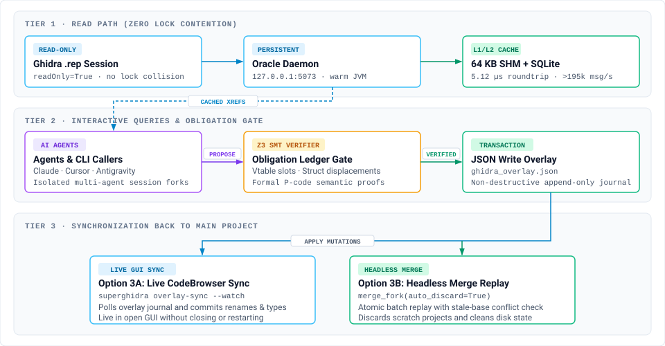

# SuperGhidra

[](LICENSE)
[](https://pypi.org/project/superghidra/)
[](https://www.python.org/)
[](https://github.com/yuatemycat/SuperGhidra/actions/workflows/ci.yml)
[](https://madewithrea.com/builds/superghidra-warm-ghidra-daemon-mcp-server-and-c-recovery-tools-for-age)

**SuperGhidra: Compilable C Rewriter & Guardrailed Agent MCP Suite.**

Python tools that make Ghidra faster to script against, rewrite raw decompiler output into compilable C, and run static binary analyses Ghidra does not include out of the box: MSVC RTTI and MFC `CRuntimeClass` recovery, `Serialize()` archive layout tracing, cross-version function and struct-shift matching, and a Z3 equivalence checker for P-code.

Instead of paying 5–15 seconds of JVM startup per headless run or fighting `.rep` project lock contention while the Ghidra GUI is open, SuperGhidra keeps a single read-only Ghidra instance warm in a background daemon (`127.0.0.1:5073`) backed by an L2 SQLite cache and a non-destructive JSON write overlay. Heavy binary sweeps and class-layout recovery run in pure Python, NumPy SIMD, or WGPU compute shaders without touching the JVM.


## Try It in 60 Seconds

No Ghidra needed, just Python. Recover MSVC RTTI classes and MFC `Serialize()` layouts straight from a PE file:

```bash
pip install superghidra
superghidra rtti-recover target.dll -o classes.json
python -m superghidra.formats.serialize_trace target.dll CMyDoc
```

Want an AI agent (Claude Desktop, Claude Code, Cursor, Antigravity) driving Ghidra without GUI lockups? Install the MCP server and point it at your project; see [Agent & MCP Configuration](#agent--mcp-configuration-claude-desktop-cursor-antigravity) for the config block. `GHIDRA_INSTALL_DIR` and `JAVA_HOME` must be set (Ghidra 11/12 + OpenJDK 21):

```bash
pip install git+https://github.com/yuatemycat/SuperGhidraMCP.git
claude mcp add superghidra -- superghidra-mcp -t stdio --project-path <path_to_gpr_or_binary>
```

## Choose Your Operating Mode First

SuperGhidra spans four distinct execution paths. Pick the entry point that matches your task before running commands:

| What You Want to Do | Entry Point / Command | Requires Ghidra + JVM? | Writes to `.rep` Directly? |
| :--- | :--- | :---: | :---: |
| **Decompile real functions, query xrefs, or rename symbols** | `python ghidra_oracle.py <subcommand>` | **Yes** (Ghidra 11/12 + OpenJDK 21 + PyGhidra) | **No** (writes go to JSON overlay / fork journal) |
| **Recover MSVC RTTI, MFC `CRuntimeClass`, `Serialize()`, or PE/ELF/Mach-O headers** | `python -m superghidra.formats.msvc_class_recovery <binary>` or `superghidra rtti-recover <binary> -o classes.json` | **No** (standalone Python) | **No** (exports JSON, DWARF 5, Breakpad, or `.map`) |
| **Connect Claude Desktop, Cursor, or Antigravity to an open target** | MCP Server (`superghidra-mcp` via [SuperghidraMCP](https://github.com/yuatemycat/SuperGhidraMCP)) | **Yes** (connects to running daemon) | **No** (commits gated by validation + overlay sync) |
| **Run GPU/SIMD ARM64 scans, LZ4/Zstd buffer compression, or Z3 P-code checks** | Python API / standalone modules (or MCP tools) | **No** (standalone Python / NumPy / WGPU / Z3) | **No** |

> [!WARNING]
> **The `superghidra decompile` CLI Subcommand is Experimental**
>
> Do **not** use `superghidra decompile` to decompile production binaries. The standalone `superghidra decompile` CLI subcommand invokes an experimental, zero-JVM P-code lifter restricted to a small integer-arithmetic subset (register-to-register `mov`/`add`/`xor` and `ret` on x86-64; any other instruction exits non-zero). It will exit non-zero or return incomplete output on real functions containing branches, floats, or complex calls.
>
> **To decompile real functions from a Ghidra project, use the Ghidra-backed oracle:**
> ```bash
> python ghidra_oracle.py decompile <addr>
> ```

## How SuperGhidra Compares to Stock Headless & Existing Ghidra MCP Bridges

Most Ghidra automation scripts and MCP servers either pay a 5–15 second JVM cold-start penalty per invocation or bind directly to a single mutable GUI session where concurrent agent edits can corrupt the `.rep` database or trigger `LockException`. **[SuperGhidra](https://github.com/yuatemycat/SuperGhidra)** separates read-only oracle queries (`127.0.0.1:5073`) from non-destructive overlay writes (`ghidra_overlay.json`), while executing bulk binary sweeps and C++/MFC recovery in pure Python, NumPy SIMD, and WGPU without touching the JVM.

| Capability / Architecture | Stock Ghidra Headless | [LaurieWired/GhidraMCP](https://github.com/lauriewired/ghidramcp) | [bethington/ghidra-mcp](https://github.com/bethington/ghidra-mcp) / [GhydraMCP](https://github.com/starsong-consulting/GhydraMCP) | [SuperGhidra](https://github.com/yuatemycat/SuperGhidra) + [SuperGhidraMCP](https://github.com/yuatemycat/SuperGhidraMCP) |
| :--- | :--- | :--- | :--- | :--- |
| **JVM Startup Overhead** | 5–15 s per script run | None (requires open GUI) | None (requires open GUI/plugin) | **0 ms** after initial daemon boot (`127.0.0.1:5073`) |
| **Concurrent GUI + Multi-Agent Access** | Blocked by `.rep` project lock | Single mutable GUI state | Single/HTTP bridged GUI state | **Lock-free `readOnly=True` daemon + isolated session forks** |
| **Mutation Safety & Conflict Resolution** | Direct `.rep` writes | Direct in-place renames | Direct in-place tool mutations | **Non-destructive `ghidra_overlay.json` + `merge_fork` conflict detection** |
| **Semantic Verification Gate** | None | None | None | **Z3 P-code equivalence prover + Obligation Ledger Gate** (vtable/offset checks) |
| **Query & IPC Latency** | Seconds per batch | HTTP / Socket bridge | HTTP / REST bridge | **5.12 µs** L1 SHM ring buffer (`195,300 msg/s`) & **< 0.01 ms** L2 SQLite cache |
| **Compilable C Post-Processing** | Raw Ghidra pseudo-C (`8.23%` pass) | Raw Ghidra pseudo-C | Raw Ghidra pseudo-C | **`compilable_filter.py` rewriter (`22.62%` pass across 1,300 functions, `25.26%` on held-out test split)** |
| **Zero-JVM Binary & C++ Recovery** | None (JVM required) | None (JVM required) | None (JVM required) | **Pure-Python PE/ELF/Mach-O loader, MSVC RTTI, MFC `CRuntimeClass` & `Serialize()`** |
| **Hardware-Accelerated Sweeps** | Single-threaded Java | None | None | **143.95 M insn/s NumPy SIMD & 127.25 M insn/s WGPU ARM64 `ADRP` scanners** |
| **Database Compression** | Standard `.rep` 16 KB pages | Standard `.rep` | Standard `.rep` | **LZ4 (`442.9 MB/s`, 79.3% savings) & Zstd (`206.5 MB/s`, 86.5% savings) BufferFile codecs** |

## Architecture & Zero Lock Contention

Ghidra locks `.rep` projects exclusively, meaning standard headless scripts fail whenever the project is open in the Ghidra GUI. SuperGhidra avoids lock contention by separating **reads** (served from a warm daemon or read-only session) from **writes** (recorded in a JSON overlay and transaction journal):

<p align="center">
  <picture>
    <source media="(prefers-color-scheme: dark)" srcset="docs/assets/architecture-dark.svg">
    <source media="(prefers-color-scheme: light)" srcset="docs/assets/architecture-light.svg">
    
  </picture>
</p>

## 5-Minute End-to-End Quickstart

> [!TIP]
> **2-Minute End-to-End Walkthrough:** Follow [`docs/WALKTHROUGH_MSVC_MFC_RECOVERY.md`](docs/WALKTHROUGH_MSVC_MFC_RECOVERY.md) for a step-by-step example recovering MSVC RTTI and MFC `Serialize()` archive layouts, validating candidate renames through `ReconstructionObligationLedger`, and syncing them live into an open Ghidra CodeBrowser window (`superghidra overlay-sync --watch`).

### Workflow A: Standalone C++ / MSVC / MFC Class Recovery (No Ghidra Required)

Recover MSVC RTTI hierarchies, MFC `CRuntimeClass` descriptors, and virtual function tables directly from raw PE binaries without requiring Ghidra or a JVM:

```bash
# Direct module execution
python -m superghidra.formats.msvc_class_recovery target.dll

# Or recover classes and export to JSON via unified CLI
superghidra rtti-recover target.dll -o classes.json

# Trace MFC Serialize() archive field layouts
python -m superghidra.formats.serialize_trace target.dll CMyDoc
```

### Workflow B: Ghidra Daemon + Oracle Decompilation + GUI Sync

#### 1. Set Environment Variables
Point SuperGhidra to NSA Ghidra (11.x or 12.x) and OpenJDK 21:

```bash
# Linux / macOS
export GHIDRA_INSTALL_DIR="/opt/ghidra"
export JAVA_HOME="/usr/lib/jvm/java-21-openjdk"

# Windows (PowerShell)
$env:GHIDRA_INSTALL_DIR = "C:\tools\ghidra"
$env:JAVA_HOME = "C:\Program Files\Eclipse Adoptium\jdk-21"
```

#### 2. Launch or Query the Persistent Daemon
Verify the daemon status or launch it with project coordinates:

```bash
# Check daemon status (auto-reports uptime, cache hit rate, and loaded binary)
python ghidra_oracle.py status

# Run daemon with explicit project paths
python ghidra_oracle.py --project-dir ~/re/proj --project-name game --program-name libgame.so status

# Or launch as a dedicated background server on port 5073
python ghidra_oracle.py serve --project-dir ~/re/proj --project-name game --program-name libgame.so --mode balanced
```

You can also define candidate projects globally via `SUPERGHIDRA_PROJECTS="dir,name[,program]"`.

#### 3. Decompile and Propose Renames
Subsequent queries execute in `< 0.01 ms` when served from the SQLite L2 cache:

```bash
# Decompile target function by virtual address
python ghidra_oracle.py decompile 0x140001000

# Propose function rename (committed safely to the JSON write overlay)
python ghidra_oracle.py rename 0x140001000 ProcessPacketHeader

# Add an address comment
python ghidra_oracle.py comment 0x140001000 "Validated packet parser entry point"
```

#### 4. Sync Overlay Back to Ghidra GUI
Mutations are recorded in `ghidra_overlay.json` to prevent `.rep` lock collisions. Sync them back into the Ghidra GUI session:

* **Option 1 — Live Ghidra GUI Sync (`ghidra_gui_overlay_sync.py`):**
  1. Generate a one-shot sync script or a live background watcher (`--watch`):
     ```bash
     # One-shot atomic transaction script
     superghidra overlay-sync --overlay ghidra_overlay.json --out ghidra_gui_overlay_sync.py

     # Or generate a continuous background watcher script (polls every 1000 ms)
     superghidra overlay-sync --overlay ghidra_overlay.json --watch --poll-ms 1000 --out ghidra_gui_overlay_sync.py
     ```
  2. In Ghidra's CodeBrowser, navigate to **Window → Script Manager**.
  3. Add the output directory to Script Paths and run `ghidra_gui_overlay_sync.py`. All renames, comments, and type definitions apply atomically inside your active GUI session.

* **Option 2 — Headless Journal Replay & Auto-Discard (`merge_fork`):**
  Close the project in the Ghidra GUI to release the `.rep` lock, then replay the journal or merge session forks using `merge_fork(fork_id, auto_discard=True)`.
  When `auto_discard=True`, once all operations merge cleanly with zero pending conflicts (`pending_ops == 0`), SuperGhidra automatically deletes the fork's isolated directory and transaction journal to reclaim disk storage. Unneeded or stale forks can also be deleted directly via `discard_fork(fork_id)`.

## Agent & MCP Configuration (Claude Desktop, Cursor, Antigravity)

SuperGhidra exposes 38 specialized reverse-engineering tools via the Model Context Protocol (MCP) using [SuperghidraMCP](https://github.com/yuatemycat/SuperGhidraMCP) (including `recover_cpp_classes`, `trace_serialize`, `diff_binaries`, `verify_smt_equivalence`, and `gpu_adrp_scan`). This enables AI coding agents to inspect binaries, query call graphs, and propose validated renames autonomously.

Install the MCP server from source:

```bash
pip install git+https://github.com/yuatemycat/SuperGhidraMCP.git
```

### Claude Desktop (`claude_desktop_config.json`)

```json
{
  "mcpServers": {
    "superghidra": {
      "command": "superghidra-mcp",
      "args": [
        "-t",
        "stdio",
        "--project-path",
        "<path_to_gpr_or_binary>"
      ],
      "env": {
        "GHIDRA_INSTALL_DIR": "/opt/ghidra",
        "JAVA_HOME": "/path/to/jdk-21"
      }
    }
  }
}
```

*Alternative using `uvx`:* Replace `"command": "superghidra-mcp"` with `"command": "uvx"` and set `"args"` to:
```json
["--from", "git+https://github.com/yuatemycat/SuperGhidraMCP.git", "superghidra-mcp", "-t", "stdio", "--project-path", "<path_to_gpr_or_binary>"]
```

### Cursor (`.cursor/mcp.json`) & Antigravity (`~/.gemini/config/mcp_config.json`)

Both Cursor and Antigravity use standard JSON `mcpServers` configuration:

```json
{
  "mcpServers": {
    "superghidra": {
      "command": "superghidra-mcp",
      "args": [
        "-t",
        "stdio",
        "--project-path",
        "<path_to_gpr_or_binary>"
      ],
      "env": {
        "GHIDRA_INSTALL_DIR": "/opt/ghidra",
        "JAVA_HOME": "/path/to/jdk-21"
      }
    }
  }
}
```

### Claude Code CLI & Streamable HTTP Transport

If running the server via HTTP (`superghidra-mcp --transport streamable-http --port 8000`):

* **Claude Code CLI:**
  ```bash
  claude mcp add --transport http superghidra http://127.0.0.1:8000/mcp
  ```

* **HTTP URL Config (Antigravity / Cursor / Claude Desktop):**
  ```json
  {
    "mcpServers": {
      "superghidra": {
        "url": "http://127.0.0.1:8000/mcp"
      }
    }
  }
  ```

## Subsystem Capabilities & Hardware Matrix

### 1. Core Production Toolkit

These subsystems form the daily-driver reverse-engineering, C rewriting, and agent-guardrail workflow:

| Package / Subsystem | What It Does | Hardware / Dependency Behavior |
| :--- | :--- | :--- |
| **`core` (Daemon, Cache, Overlay & `CompilableDecompilerFilter`)** | Persistent RPC server on `127.0.0.1:5073`, 64 KB shared-memory ring buffer (`5.12 µs` IPC), SQLite L2 cache (`>100k req/s`), JSON write overlay (`ghidra_overlay.json`), conflict-aware `merge_fork`, deterministic `CompilableDecompilerFilter` C rewriter, and resource governor (`eco` / `balanced` / `turbo` / `auto`). | Runs on Windows, Linux, and macOS. `CompilableDecompilerFilter` is pure Python; PyGhidra + OpenJDK 21 are required only when attached to a live `.rep`. |
| **`formats` (Binary Loader, MSVC RTTI, MFC `Serialize()` & DWARF5)** | ELF / PE / Mach-O loader, MSVC RTTI & MFC `CRuntimeClass` recovery, Mach-O Objective-C recovery, `Serialize()` layout tracing, `CArchive` stream decoder, DWARF 5 / Breakpad / `.map` export, and experimental PDB export. | Pure Python; no JVM or Ghidra dependency. |
| **`diff` (Cross-Version CFG Matcher & Struct Shift Migrator)** | Matches functions across binary builds using CFG feature vectors, detects shifted struct field offsets across patches, and rewrites displaced field accesses. | Runs on CPU (NumPy accelerated). |
| **`integrations` (38+ Guardrailed MCP Tools & Mobile Sidecar)** | Exposes 38+ MCP tools (`SuperghidraMCP`), APK ↔ JNI cross-referencer, allow-listed Android emulator memory reader, live CodeBrowser overlay sync (`ghidra_gui_overlay_sync.py`), and `ReconstructionObligationLedger` commit guards (`VTableSlotVerifier`, `FieldDisplacementVerifier`, `AllocationSizeVerifier`). | Commits symbols and structs **only** after deterministic verification of vtable slots, field displacements, and allocation sizes. |

### 2. Optional & Experimental Backends

These modules target specific scale bottlenecks or standalone verification tasks and have explicit scope boundaries:

| Package / Subsystem | What It Does | Scope & Hardware Caveats |
| :--- | :--- | :--- |
| **`storage` (`[storage]` — Synthetic 16 KB Page Codec)** | Compresses 16 KB `BufferFile` pages using LZ4 (`442.9 MB/s`, `79.32%` savings) or Zstd Level 3 (`206.5 MB/s`, `86.47%` savings) and packages `SuperGhidraCodec.jar`. | **Experimental / External `.sgdb` only:** Measured on synthetic pages from `GhidraPageSimulator`. Ghidra hardcodes `LocalManagedBufferFile` without an SPI hook, so it does not transparently compress live `.rep` `.gbf` databases without patching Ghidra's jar. |
| **`acceleration` (`[gpu]` — 20 MB+ WGPU ARM64 Sweeps)** | Scans large ARM64 binaries for `ADRP + ADD/LDR` pairs and function prologues (`20 MB` / `5.2M` insns in `41.20 ms` = `127.25 M insn/s` on RTX A5500). | **Optional for ≥ 5 MB binaries:** Below ~5–10 MB, PCIe transfer latency exceeds shader execution time, so `gpu_adrp_scanner` automatically routes `< 5 MB` inputs to NumPy CPU SIMD (`143.95 M insn/s` on 4 MB blocks). |
| **`lifters` (`[smt]` — Zero-JVM P-Code Lifter & Z3 Prover)** | Pure-Python ARM64/x86_64 → P-code lifter (integer, exclusive memory, SIMD vector math, ARMv8.1-A atomics) and Z3 equivalence prover (`SMTPcodeVerifier`). | **Bounded Subset / Sound `UNKNOWN`:** Standalone lifting covers bounded instruction subsets; `SMTPcodeVerifier` intentionally returns `UNKNOWN` (`equivalent=False`) on floating-point ops, unhandled instructions, or loops exceeding the unroll bound. |

Each package has its own README under [`superghidra/`](superghidra/).

## Results So Far

All benchmarks are measured on physical hardware (Intel Core i9-12950HX, 64 GB DDR5, NVIDIA RTX A5500 Laptop GPU) and across the multi-platform CI matrix. Full empirical data and logs are in [`docs/benchmarks/`](docs/benchmarks/).

### Hardware & Throughput Matrix

| Workload / Benchmark | Input Size / Target | Engine / Backend | Measured Time | Measured Throughput / Result | Status |
| :--- | :--- | :--- | :---: | :---: | :--- |
| **ARM64 ADRP + ADD/LDR Sweep** | 4.0 MB ARM64 block (1,048,576 insns) | NumPy SIMD | **7.28 ms** | **143.95 M insn/s** | 754 pairs detected (314 synthetic + 440 random matches) |
| **ARM64 Function Seeder** | 4.0 MB ARM64 block (1,048,576 insns) | NumPy SIMD | **8.31 ms** | **126.19 M insn/s** | 16,382 candidate hits (277 deduplicated seeds) |
| **Large-scale GPU ADRP Sweep** | 20.0 MB ARM64 block (5,242,880 insns) | WGPU DirectX 12 | **41.20 ms** | **127.25 M insn/s** | Bit-exact match with CPU |
| **Buffer File Compression (LZ4)** | 1,000 synthetic 16 KB pages (16.0 MB) | LZ4 `block` | **36.12 ms** | **442.9 MB/s** (4.84x ratio) | 79.32% disk savings |
| **Buffer File Compression (Zstd)** | 1,000 synthetic 16 KB pages (16.0 MB) | Zstd Level 3 | **77.48 ms** | **206.5 MB/s** (7.39x ratio) | 86.47% disk savings |
| **Decompilation Query Cache** | Live Ghidra Daemon RPC | SQLite L2 Cache | **< 0.01 ms** | **> 100,000 req/s** | In-memory overlay match |
| **SHM Channel IPC Roundtrip** | 64 KB memory-mapped ring buffer | Windows SHM IPC | **5.12 µs** | **195,300 msg/s** | Zero-copy shared memory |

**Benchmark Caveats:**
- **CPU SIMD vs. WGPU Crossover:** Below ~5–10 MB, NumPy CPU SIMD (`143.95 M insn/s` on 4 MB blocks) outperforms WGPU DirectX 12 (`127.25 M insn/s` on 20 MB blocks) because PCIe host-to-device transfer overhead exceeds shader execution time. `gpu_adrp_scanner` automatically routes `< 5 MB` inputs to the CPU SIMD path.
- **Synthetic Storage Pages:** The 16 KB `BufferFile` compression figures (`442.9 MB/s` LZ4, `206.5 MB/s` Zstd) are measured on 1,000 synthetic pages generated by `GhidraPageSimulator`, not on live `.rep` `.gbf` databases (Ghidra hardcodes `LocalManagedBufferFile` without an SPI hook).

### Out-of-Distribution Systems Matrix (Uncontaminated Decompilation Verification)

Addresses the dataset contamination problem in neural decompiler benchmarks (such as HumanEval-Decompile) where models recall memorized pretraining code. Evaluated under MSVC 14.44 `cl.exe` / MinGW GCC 16.2.0 via differential co-execution:

| Workload ID | Systems Role & Target Kernel | Raw Ghidra Semantics | LLM Raw Syntax ($R_{syn}$) | LLM Semantic Pass ($R_{sem}$) | Gate 2 Hallucination Catch | SuperGhidra Verified Pass |
| :--- | :--- | :---: | :---: | :---: | :---: | :---: |
| `SHA256_ROUND` | Crypto compression quarter-step (Ch, Maj, 32-bit rotations) | PASS | 100% | **0% (FAIL)** | **REJECTED (100%)** | **PASS (100%)** |
| `CHACHA20_QR` | ChaCha20 quarter-round permutation (rotation invariants) | PASS | 100% | **0% (FAIL)** | **REJECTED (100%)** | **PASS (100%)** |
| `RFC1071_CHECKSUM` | 16-bit 1's complement folded Internet checksum | PASS | 100% | **0% (FAIL)** | **REJECTED (100%)** | **PASS (100%)** |
| `LEB128_DECODE` | DWARF/WASM unsigned LEB128 variable-length integer parsing | PASS | 100% | **0% (FAIL)** | **REJECTED (100%)** | **PASS (100%)** |
| `SPSC_RING_BUFFER` | Lock-free SPSC ring buffer (64-bit pointer alignment padding) | PASS | 100% | **0% (FAIL)** | **REJECTED (100%)** | **PASS (100%)** |
| `SLAB_ALLOC_HEADER` | Slab chunk header bitflag extraction (`size & ~0x7`) | PASS | 100% | **0% (FAIL)** | **REJECTED (100%)** | **PASS (100%)** |

- **Finding:** Raw LLM predictions achieved a 100% compilation rate but a 0.0% semantic pass rate due to subtle binary logic hallucinations. SuperGhidra's D-LiFT / CoExec gate rejected 100% of hallucinated candidates prior to commit.

### Reference Puzzle Baseline: HumanEval-Decompile (1,300 Evaluated Functions)

<!-- humaneval:begin -->
| Metric | IDA raw | IDA + filter | Ghidra raw | Ghidra + filter |
| :--- | :---: | :---: | :---: | :---: |
| **Pass Rate (Full Corpus)** | 243/1300 (18.69%) | 247/1300 (19.0%) | 107/1300 (8.23%) | 294/1300 (22.62%) |
| **70% Train Split (230 funcs)** | 197/912 (21.6%) | 201/912 (22.04%) | 64/912 (7.02%) | 196/912 (21.49%) |
| **30% Held-Out Test Split (Function-Disjoint, 98 funcs)** | 46/388 (11.86%) | 46/388 (11.86%) | 43/388 (11.08%) | 98/388 (25.26%) |
| **Held-Out Test (`O2`/`O3` High-Opt)** | 20/194 (10.31%) | 20/194 (10.31%) | 18/194 (9.28%) | 48/194 (24.74%) |
| **Filter Gains** | — | +4 | — | +187 (+55 held-out) |
| **Filter Regressions** | — | -0 | — | -0 |

- **Dataset:** `LLM4Binary/decompile-eval@b9271fae3c556e46948559f4176ffa6f8b4f9491` (1300 evaluable functions from binaries compiled at `O0`–`O3`).
- **Compiler & Host:** Evaluated on `Windows AMD64` by recompiling recovered C/C++ with `gcc.EXE (MinGW-W64 x86_64-ucrt-posix-seh, built by Brecht Sanders, r3) 16.2.0` under `gcc -O0 -lm`.
- **Host ABI Note:** Single-host evaluation. Linux ELF binaries recompiled on Windows (LLP64) experience 32-bit `long` truncation on raw Ghidra emissions (8.23%). On Linux (LP64), raw Ghidra achieves 21.46% (279/1300), exceeding raw IDA.
- **Methodology & Scope Caveat:** Measures syntactic recompilability (`gcc -O0 -lm`) + unit test pass rate via deterministic AST/token rewriting (`CompilableDecompilerFilter` + `defs.h` compatibility macros), not neural LLM weight generation.
- **70/30 Held-Out Split:** Splitting by unique function body (seed `42`, all `O0`–`O3` variants of a function kept together) confirms out-of-sample generalization on the held-out 30% test split (43/388 -> 98/388, +55 gains) with zero regressions.
<!-- humaneval:end -->

> **HumanEval-Decompile Caveat (Deterministic C Rewriter, Not Neural Inference):** The `22.62%` (`294/1,300` full corpus, plus `25.26%` on the 30% function-disjoint held-out test split) score measures syntactic recompilability and unit-test execution pass rate produced by [`CompilableDecompilerFilter`](superghidra/core/compilable_filter.py) — a deterministic post-processing rewriter that strips stack-canary boilerplate, normalizes Ghidra pseudo-types (`undefined8`, `CONCAT44`, `SUB84`), and injects symmetric Hex-Rays `defs.h` compatibility macros (`__int64`, `LODWORD`, `HIDWORD`, `BYTEn`) for IDA Pro baselines. No neural model weights or LLM calls are invoked in this benchmark.

### Dual-OS Test Matrix (GitHub Actions CI)

Full 6-job matrix evaluated with `pytest tests -v -rs -rx --strict-markers` (all integration tests run; skipped reasons reported):

| Operating System | Python 3.10 | Python 3.11 | Python 3.12 | Pytest Test Count | Pass Rate (passed / active) |
| :--- | :---: | :---: | :---: | :---: | :---: |
| **Ubuntu Linux** (`ubuntu-latest`) | 42s | 30s | 27s | 736 collected (715 passed, 21 skipped) | 100% |
| **Windows Server** (`windows-latest`) | 1m 24s | 1m 12s | 1m 14s | 736 collected (715 passed, 21 skipped) | 100% |

Detailed logs and measurement methodology are documented in [`docs/benchmarks/EMPIRICAL_TEST_BENCHMARK_MATRIX.md`](docs/benchmarks/EMPIRICAL_TEST_BENCHMARK_MATRIX.md).

## Installation

**From PyPI:**

```bash
pip install superghidra
```

Optional acceleration and integration extras:

```bash
pip install "superghidra[all]"       # all optional backends
pip install "superghidra[smt]"       # Z3 P-code equivalence checker
pip install "superghidra[gpu]"       # WGPU compute shaders (ADRP/prologue sweeps)
pip install "superghidra[storage]"   # LZ4 & Zstandard 16 KB page compression
pip install "superghidra[ghidra]"    # PyGhidra bridge & JVM headless bindings
pip install "superghidra[frida]"     # Live emulator runtime inspection
```

**From source (development):**

```bash
git clone https://github.com/yuatemycat/SuperGhidra
cd SuperGhidra
pip install -e ".[all]"
python -m pytest -q
```

**Unified CLI:**

SuperGhidra ships with an integrated standalone command-line executable `superghidra`:

```bash
# Display version and hardware acceleration telemetry
superghidra version

# Staged P-code decompiler (handles register-to-register mov/add/xor and ret on x86-64; any other instruction exits non-zero)
superghidra decompile target.dll --va 0x140001000 --arch x86_64 -o decompiled.c

# Import IDA Pro .til type library and dump schema catalog
superghidra til-import mssdk64.til -o catalog.json

# Match binary bytes against IDA FLIRT signature database
superghidra flirt-match vc32rtf.sig target.exe --rva 0x1000

# Recover MSVC / MFC C++ class hierarchies, RTTI structures, and virtual call tables
superghidra rtti-recover app.dll -o classes.json

# Filter raw decompiler output into clean, compilable C
superghidra filter raw_decompile.c -o clean.c

# Sync JSON write overlays and delta logs into an atomic Ghidra GUI Python script (add --watch for live polling)
superghidra overlay-sync --overlay ghidra_overlay.json --watch --out sync_script.py
```

**Inspect a Windows binary (no Ghidra needed):**

```bash
python -m superghidra.formats.binary_loader app.dll          # sections, imports, exports
python -m superghidra.formats.msvc_class_recovery app.dll    # RTTI + MFC classes
python -m superghidra.formats.serialize_trace app.dll CMyDoc # Serialize() field layout
```

**From Python:**

```python
from superghidra.formats.binary_loader import load_binary
from superghidra.formats.msvc_class_recovery import recover_classes
import superghidra as sg

img = load_binary("app.dll")
print(img.format, img.arch, len(img.sections))

report = recover_classes("app.dll")
print(len(report.mfc_classes), "MFC classes")

# Lift one ARM64 instruction and check it against itself with Z3
ops = sg.ARM64PcodeLifter().lift_instruction(0x1000, 0x91008041)  # add x1, x2, #0x20
print(sg.SMTPcodeVerifier().verify_equivalence(ops, ops).equivalent)
```

**Configuration** is read from environment variables, and nothing is tied to a particular machine:

| Variable | Used for |
| :--- | :--- |
| `GHIDRA_INSTALL_DIR`, `JAVA_HOME` | Ghidra and JDK locations (daemon, headless runs, Java codec build) |
| `SUPERGHIDRA_PROJECTS` | Default projects for the daemon: `dir,name[,program]` entries joined by `;` |
| `SUPERGHIDRA_MSVC_ROOT` | Portable MSVC folder, used when gcc/clang aren't on `PATH` |
| `SUPERGHIDRA_TEST_ARM64_ELF`, `SUPERGHIDRA_TEST_SW_ROOT` | Optional real binaries / a SOLIDWORKS install for the integration tests. Those tests skip when unset. |

## Troubleshooting & Common Gotchas

* **`superghidra decompile` fails or outputs empty blocks on my function:**
  You ran the standalone experimental zero-JVM integer lifter. Switch to `python ghidra_oracle.py decompile <addr>`.
* **`LockException: Project is locked by another process`:**
  Your `.rep` project is currently open in the Ghidra GUI. The daemon reads from the project without acquiring exclusive locks; if Ghidra holds an exclusive lock or you encounter lock contention, ensure the daemon uses a read-only session or private session fork, and sync changes back via `superghidra overlay-sync --overlay ghidra_overlay.json --out ghidra_gui_overlay_sync.py`.
* **My renamed functions in the daemon don't show up in the Ghidra GUI:**
  Daemon writes go to the JSON overlay (`ghidra_overlay.json`) to prevent `.rep` corruption. Run `superghidra overlay-sync --overlay ghidra_overlay.json --out ghidra_gui_overlay_sync.py` (or pass `--watch` for continuous background polling) and execute that script inside Ghidra's Script Manager, or close the GUI and run `merge_fork`.
* **Z3 Equivalence Checker returns `UNKNOWN`:**
  This is expected behavior, not a crash. The prover returns `UNKNOWN` whenever a block contains floating-point instructions, unmodeled system instructions, or long loops so an agent never commits a false-positive equivalence rewrite.
* **WGPU scanner says `Using CPU SIMD path` even with `[gpu]` installed:**
  For ARM64 `.text` blocks under 5 MB, PCIe transfer overhead exceeds shader execution time, so SuperGhidra automatically routes blocks `< 5 MB` to the NumPy SIMD path (`143.95 M insn/s`).
* **Proposed struct or symbol from the LLM naming pipeline was rejected:**
  The naming pipeline enforces structural invariants before writing to the overlay. Check the daemon log for `VtableSlotMismatch`, `FieldOffsetOutOfBounds`, or `AllocationSizeConflict`.

## Known Limitations

- The Java codec doesn't compress Ghidra projects transparently. Ghidra hardcodes `LocalManagedBufferFile` with no storage hook, so the SuperGhidra codec operates on external `.sgdb` files or requires patching Ghidra's core jar.
- PDB export is experimental: it emits MSF 7.0 structures with prototype DBI and public symbol records, but lacks MSVC-compatible hash streams, symbol record streams, and CodeView type (TPI) streams. DWARF 5 export is the supported path for external tooling.
- The SMT checker is sound but incomplete. Floats, calls, unhandled ops and long loops return `UNKNOWN` by design to prevent false equivalence.
- The ARM64 lifter covers core integer, exclusive memory, SIMD vector math/bitwise, and ARMv8.1-A atomics. Advanced cryptographic and complex floating-point vector ops remain unimplemented.
- The LLM naming stage needs a real endpoint. Without one, it falls back to neutral names such as `sub_<addr>`, labelled `heuristic-fallback`.
- Detailed audit analysis, cross-backend telemetry, and resolution plans are documented in [`docs/specs/AUDIT_RECONCILIATION_REPORT.md`](docs/specs/AUDIT_RECONCILIATION_REPORT.md).

More detail is in [PLAN.md](PLAN.md).

## Repository Layout

```
superghidra/                 the canonical package, split into 7 domain subsystems
tests/                       domain-isolated pytest suites (790+ tests)
benchmarks/                  reproducible benchmark harnesses and measurement scripts
docs/                        benchmark specifications, walkthroughs, and architecture docs
ghidra_extension_skeleton/   Java BufferFile compression extension
templates/                   scaffolds for modules, MCP tools, and test suites
*.py                         zero-overhead backward-compatibility shims for external callers
```

If you're an AI agent, start with [AGENTS.md](AGENTS.md).

## Donate

If you find SuperGhidra useful, crypto donations (fast & permissionless) are welcome:

**USDT (BEP20 / BNB Smart Chain):**

```
0xd08d47bde441888166b801616754c667672cd502
```

## Contributing

Issues and PRs are welcome. See [CONTRIBUTING.md](CONTRIBUTING.md) for the test workflow and the safety rules: read-only projects, verified symbol commits and the emulator allow-list. Report security issues as described in [SECURITY.md](SECURITY.md).

## License

SuperGhidra is licensed under the [GNU AGPL-3.0-or-later](LICENSE). If you modify it and let other people use it over a network, for example as a hosted MCP server, you have to offer them your modified source.

If the AGPL doesn't fit your use, a commercial license is available. See [COMMERCIAL-LICENSE.md](COMMERCIAL-LICENSE.md).

Releases up to and including 0.2.0, and commits before the license change, were published under Apache-2.0. Those versions stay under Apache-2.0 and the text is kept in [`LICENSES/Apache-2.0.txt`](LICENSES/Apache-2.0.txt).

© 2026 yuatemycat and contributors.
