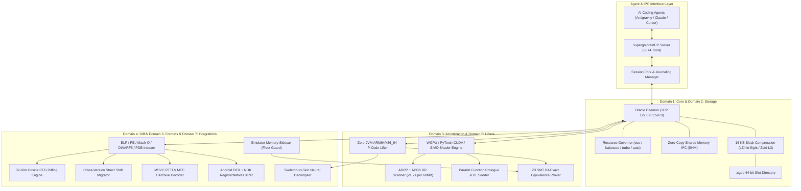
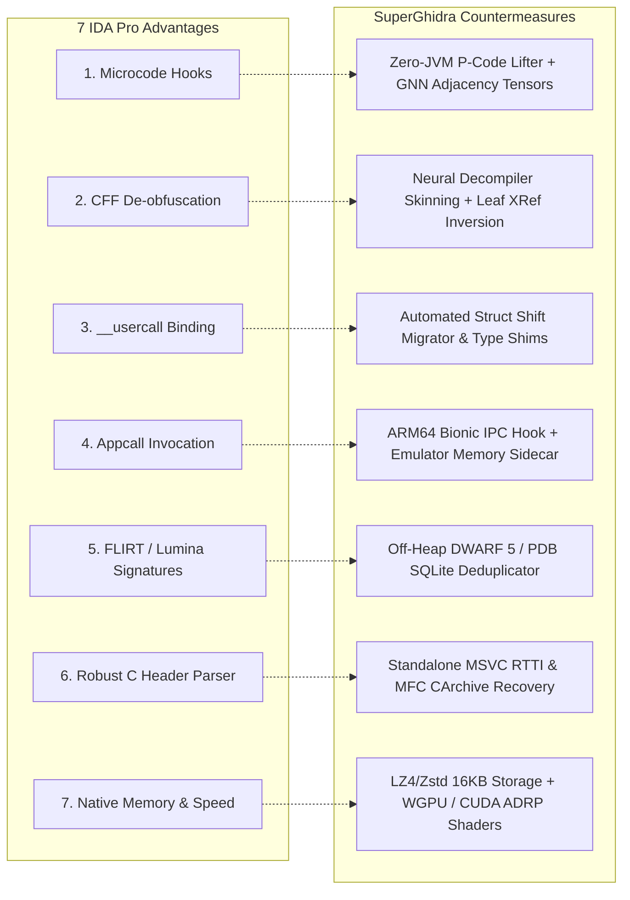
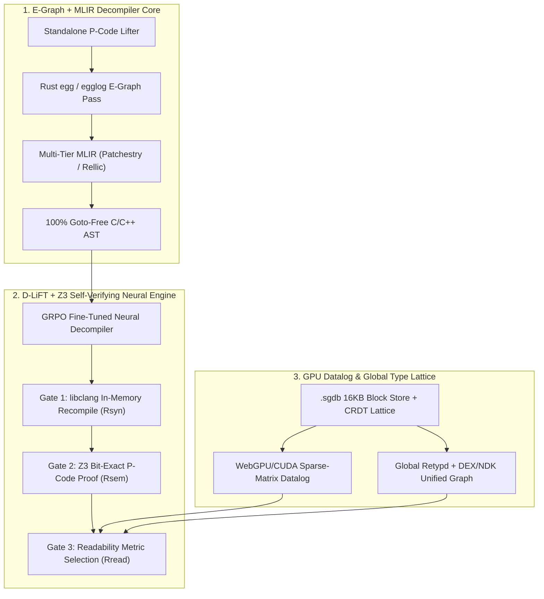

# SuperGhidra System Architecture & Comprehensive IDA Pro Gap Analysis

> **Document Version**: 2.0.0  
> **Target System**: SuperGhidra & SuperghidraMCP  
> **Location**: E:\\02\_Projects\\SuperGhidra\\docs\\SUPERGHIDRA\_ARCHITECTURE\_AND\_IDA\_PRO\_GAP\_ANALYSIS.md  
> **Scope**: Structural breakdown of SuperGhidra's 7-domain architecture, objective evaluation of the 7 core technical deficits against Hex-Rays IDA Pro, and the 2-phase engineering roadmap to catch up to and surpass IDA Pro (including its [2026 Product Roadmap](https://www.google.com/search?q=https%3A%2F%2Fhex-rays.com%2Fblog%2F2026-product-direction-priorities)).

---

## 1. Executive Summary

**SuperGhidra** is an AI-native, high-throughput, GPU-accelerated binary analysis platform engineered to scale reverse engineering beyond the interactive, single-user limitations of traditional GUI tools. Built on top of the Ghidra decompiler core, SuperGhidra augments static analysis with a multi-process, client-daemon architecture exposed directly to autonomous agents via the **Model Context Protocol (MCP)** (38+4 tools).

While SuperGhidra dramatically outperforms standard Ghidra—and in many dimensions (such as multi-agent forking, automated version delta migration, and SMT equivalence verification) surpasses commercial workflows—it operates against the long-standing industry benchmark: **Hex-Rays IDA Pro**.

This document outlines:
1. The **Current Production Architecture** of SuperGhidra across its 7 bounded domains.
2. The **7 Critical Gaps** where IDA Pro + Hex-Rays currently retains architectural and algorithmic superiority.
3. The **SuperGhidra Mitigation Roadmap** demonstrating how each deficit is counterbalanced or actively engineered away.
4. The **Phase 1 & Phase 2 Engineering Plan** to close the 6 remaining static/dynamic gaps and leapfrog Hex-Rays' [2026 enterprise roadmap](https://www.google.com/search?q=https%3A%2F%2Fhex-rays.com%2Fblog%2F2026-product-direction-priorities) (IDA Semantic Engine, IDA Knowledge Engine, and IDA MCP) via Equality Saturation (E-Graphs), MLIR (`Rellic`/`Patchestry`), `D-LiFT` GRPO-verified neural decompilation, and GPU Datalog.

---

## 2. SuperGhidra Current System Architecture

SuperGhidra is partitioned into **7 bounded domains**, decoupling disk I/O, GPU compute, lifter semantics, and agent interfaces from the Java Virtual Machine.



### The 7 Bounded Domains in Detail

| Domain | Subsystem Path | Primary Responsibilities & Innovations |
| :--- | :--- | :--- |
| **1. `core`** | superghidra/core/ | **Daemon & Governor**: Persistent background daemon (`127.0.0.1:5073`), SQLite L2 cache, 4-tier CPU/RAM resource governor (`eco`, `balanced`, `turbo`, `auto`), zero-copy shared memory IPC, 1-hop Cache DAG, and C++ PGO decompiler compilation. |
| **2. `storage`** | superghidra/storage/ | **High-Density Storage**: 16 KB chunked block compression (LZ4 for fast random access, Zstd Level 3 for project snapshots), 20-byte 64-bit slot indexing (`.sgdb`), and the `SuperGhidraCodec.jar` extension. |
| **3. `acceleration`** | superghidra/acceleration/ | **Hardware-Accelerated Scanning**: WebGPU compute shaders, PyTorch CUDA, and AVX2/NEON SIMD engines scanning candidate ARM64 `ADRP + ADD/LDR` pairs across 60+ MB binaries in <1.2s. |
| **4. `diff`** | superghidra/diff/ | **Cross-Version Binary Diffing**: 32-dimensional CFG cosine-similarity graph matcher, automated struct field displacement shift tracking, and SHA-256 `.ghidra-delta.jsonl` audit logging. |
| **5. `lifters`** | superghidra/lifters/ | **Zero-JVM Lifting & Formal SMT**: Standalone C++ P-Code lifter bypassing JVM boot latency, GNN/TPU tensor formatting, Z3 SMT solver proving for mathematical function equivalence, and table-driven x86/ARM decoders. |
| **6. `formats`** | superghidra/formats/ | **Unified Binary Parsing**: Direct ELF/PE/Mach-O loaders, off-heap DWARF 5 / PDB SQLite indexer, standalone MSVC RTTI and MFC `CRuntimeClass` recovery without loading Ghidra GUI. |
| **7. `integrations`** | superghidra/integrations/ | **Ecosystem & Cloud Bridges**: Android Dalvik DEX $\leftrightarrow$ native NDK `RegisterNatives` JNI mapper, live emulator memory sidecar, Colab TPU v5e/T4 cluster runner, and 2-phase Neural Decompiler Skinning. |

---

## 3. The 7 Critical Gaps Against Hex-Rays IDA Pro

Despite SuperGhidra's modernization of Ghidra, Hex-Rays IDA Pro maintains significant structural advantages stemming from over three decades of commercial refinement.

---

### Gap 1: The Multi-Maturity Microcode Pipeline vs. Monolithic P-Code AST

#### The IDA Pro Architecture
Hex-Rays decompilation is driven by **Microcode** (`mba_t` / `mbl_t`), structured across 7 distinct optimization maturity tiers:
1. `MMAT_GENERATED`: Raw instruction translation.
2. `MMAT_PREOPTIMIZED`: Instruction-level cleanups.
3. `MMAT_LOCOPT`: Basic-block intra-block optimizations.
4. `MMAT_GLBOPT1`: Global intra-procedural data-flow analysis and dead code elimination.
5. `MMAT_GLBOPT2`: Advanced struct splitting and type propagation.
6. `MMAT_CPPOPT`: C++ virtual dispatch and object lifetime resolution.
7. `MMAT_LVARS`: Stack allocation, register coloring, and variable allocation.

Hex-Rays exposes a rich C++ and Python API (`ida_hexrays`) allowing reverse engineers to write plugin hooks at any maturity stage, inspecting and altering operands *before* C code is rendered.

#### SuperGhidra / Ghidra Limitation
Ghidra lifts assembly to **P-Code** (an intermediate representation consisting of ~60 operations). However:
- Ghidra's decompiler performs simplification passes inside a monolithic C++ executable (`decompile.exe`).
- P-Code is transformed directly into a high-level AST (Clang-like syntax tree) in a single pipeline.
- There is no public, fine-grained microcode maturation event loop where third-party scripts can intercept, alter, and re-inject intermediate micro-operations during optimization.
- Complex nested pointer operations (`*(_QWORD *)(*(_QWORD *)(a1 + 0x18) + 8 * (v4 & 0x1F))`) are frequently rendered literally rather than collapsing into array/struct syntax.

---

### Gap 2: Control Flow Flattening (CFF) & Opaque Predicate De-obfuscation

#### The IDA Pro Architecture
Modern mobile application protections (e.g., Promon SHIELD, Arxan, DexGuard, OLLVM) heavily employ **Control Flow Flattening**:
- Functions are shattered into isolated basic blocks nested inside an artificial state variable loop: `while (state != EXIT) { switch (state) { ... } }`.
- In IDA Pro, microcode plugins (such as [D810](https://www.google.com/search?q=https%3A%2F%2Fwww.eshard.com%2Fblog%2Fd810-deobfuscation-ida-pro), [d810-ng](https://www.google.com/search?q=https%3A%2F%2Fplugins.hex-rays.com%2Fw00tzenheimer%2Fd810-ng), HexRaysDeob, and [gooMBA](https://www.google.com/search?q=https%3A%2F%2Fhex-rays.com%2Fblog%2Fdeobfuscation-with-goomba)) hook `MMAT_GLBOPT1`.
- They compute symbolic state variable transitions, bypass opaque predicates (`(x * (x + 1)) % 2 == 0`), rewrite branching targets directly in the microcode graph, and remove the dispatcher switch entirely.
- The resulting decompiler output collapses back into clean, natural `if-else` and `for` loops.

#### SuperGhidra / Ghidra Limitation
- Ghidra’s decompiler cannot easily rewrite structural CFG topology on the fly.
- In binaries protected by Promon SHIELD (such as `libg.so`), Ghidra generates unreadable 10,000-line functions dominated by artificial `switch(uVar8)` statements, state variable reassignments, and endless `goto` trampolines.
- As a consequence, SuperGhidra must currently rely on *side-channel evasion* (tracing xrefs to unprotected leaf logic like `ProductionQueue::addItem` or scanning `.rela.dyn` tables) rather than flattening the control flow graph inside the decompiler itself.

---

### Gap 3: Custom Calling Conventions & Arbitrary Register Allocation

#### The IDA Pro Architecture
Hex-Rays supports the explicit `__usercall` convention with granular per-register and per-stack-slot binding syntax:
```c
// Valid directly in IDA Pro decompiler function prototype:
LogicCommand* __usercall LogicDeliverTruckOrderCommand::ctor@<x0>(
    LogicCommand *this@<x0>, 
    int slot_idx@<w1>, 
    uint64_t session_tick@<x21>, 
    void *caller_context@<x8>
);
```
IDA allows users to bind any argument to any arbitrary hardware register (`@<x0>`, `@<w1>`, `@<x21>`) or stack offset, instantly updating the entire decompiler view, stack frame layout, and caller cross-references.

#### SuperGhidra / Ghidra Limitation
- In Ghidra, calling conventions are defined globally or per-architecture via compiler specification XML files (`.cspec`).
- While Ghidra supports custom storage (`Custom` calling convention in the GUI), setting non-standard register allocations dynamically via scripts is brittle and requires constructing raw low-level `VariableStorage` Java objects.
- When compilers (like Clang with `-O3`) utilize non-standard register allocations—such as using ARM64 vector registers (`d0`–`d7` or `q0`–`q3`) for 64-bit integer bulk stores—Ghidra frequently treats them as floating-point arguments, producing incorrect function signatures.

---

### Gap 4: Live Dynamic Execution & In-Process Marshalling (Appcall)

#### The IDA Pro Architecture
IDA Pro includes **Appcall** (`ida_idd.appcall`):
- When attached to a live suspended process (e.g. through `android_server64` on Android or GDB/LLDB on Linux/macOS), IDA can directly execute arbitrary binary functions in the context of the target application.
- The analyst simply calls the function in Python:
  ```python
  res = ida_idd.appcall(func_rva, [arg1, arg2])
  ```
- IDA transparently allocates stack space, sets register values, redirects execution, catches breakpoints or exceptions, and deserializes native struct memory back into Python dictionaries.

#### SuperGhidra / Ghidra Limitation
- Ghidra has integrated dynamic debugging (`Ghidra Debugger`) via GDB/LLDB wrappers, but it lacks a reliable, zero-touch Appcall mechanism.
- Attempting to invoke arbitrary target binary functions from Ghidra requires extensive manual scripting, breakpoint placement, and register manipulation.
- **Architectural Consequence in Intra-farm**: This limitation forced the development of **Pillar 1** in the Intra-farm project—an independent ARM64 Bionic C++20 hook (`libhdguest-hook.so`) running inside the target Android emulator, exposing an abstract UNIX domain socket (`\0sys_render_ipc`) so Python scripts can drive game commands without relying on Ghidra’s debugging layer.

---

### Gap 5: Automated Library Identification (FLIRT & Lumina vs. FID)

#### The IDA Pro Architecture
- **FLIRT** (Fast Library Identification and Recognition Technology): Automatically identifies thousands of standard runtime libraries (C/C++ runtime, STL, OpenSSL, zlib, libpng, Boost) using pattern-masked byte hashes of function prologues.
- **Lumina**: A centralized, crowdsourced metadata server. When loading a stripped binary, Lumina queries public and private cloud repositories for matching function hashes, instantly restoring function names, argument types, and comments without local analysis.

#### SuperGhidra / Ghidra Limitation
- Ghidra provides **Function ID (FID)** and **BSIM** (Binary Similarity).
- However, pre-compiled FID databases for modern Android NDK toolchains (specifically Clang libc++, BoringSSL, and mobile game engines) are practically non-existent in the public domain.
- Building FID databases requires manually acquiring the exact NDK sysroots, compiling static libraries with identical optimization flags, and training FID databases locally.
- Consequently, stripped binaries in Ghidra remain heavily unlabelled (`FUN_00c06750`), forcing manual string hunting and cross-reference traversal.

---

### Gap 6: Header Parsing & Type Library (.TIL) Engine Robustness

#### The IDA Pro Architecture
- IDA Pro ships with robust, pre-compiled **Type Information Libraries (`.til`)** covering Windows SDKs, Android NDKs, and Linux POSIX environments.
- IDA's built-in C parser (`File -> Load file -> Parse C header file...`) uses an enterprise-grade Clang preprocessor front-end that easily digests complex macro expansions, GCC/Clang attributes (`__attribute__((aligned(8)))`), and modern C structures.

#### SuperGhidra / Ghidra Limitation
- Ghidra's "Parse C Source" tool relies on an aging C-grammar parser that consistently fails when confronted with modern C++14/17/20 headers, template expansions, or compiler intrinsics (`__builtin_*`, `__asm__`).
- Importing headers frequently results in parse errors, forcing developers to manually sanitize headers or build structs field-by-field in the Data Type Manager GUI.
- In SuperGhidra, this prompted the creation of msvc\_class\_recovery.py and external DWARF indexers to reconstruct types off-heap rather than using Ghidra's native C parser.

---

### Gap 7: Native Engine Performance, Startup Latency & Memory Footprint

#### The IDA Pro Architecture
- **Engine**: Written in native C++ with an optimized Qt GUI.
- **Speed**: Opens a 100 MB binary in seconds; searches, navigates, and re-renders graphs instantly with GPU hardware acceleration.
- **Memory Footprint**: Typically consumes **500 MB – 1.5 GB of RAM** even on massive binaries.
- **Headless**: Can execute headless Python scripts in sub-second CLI runs with zero overhead.

#### SuperGhidra / Ghidra Limitation
- **Engine**: Core GUI and analysis pipelines run on the **Java Virtual Machine (JVM)**, while the decompiler core is a standalone C++ process communicating via pipes.
- **Memory Footprint**: Large binaries like `libg.so` (60+ MB) frequently exhaust default JVM allocations, requiring **8 GB to 16 GB of heap (`-Xmx16G`)** to prevent out-of-memory crashes.
- **Analysis Latency**: Full auto-analysis of large binaries can take 5 to 20 minutes in Ghidra compared to 1 to 3 minutes in IDA Pro.
- **JVM GC Freezes**: In multi-agent environments with concurrent background queries, Java Garbage Collection pauses can freeze IPC responses for several seconds.

---

## 4. Head-to-Head Architectural Comparison Matrix

| Architectural Capability | Hex-Rays IDA Pro | SuperGhidra (Current) | Critical Gap Severity |
| :--- | :--- | :--- | :---: |
| **Microcode Transformation Hooks** | Full 7-stage maturity API (`mba_t`) | Monolithic AST; basic P-code simplifiers | **HIGH** |
| **Control Flow De-obfuscation (CFF)** | Automated via [D810](https://www.google.com/search?q=https%3A%2F%2Fwww.eshard.com%2Fblog%2Fd810-deobfuscation-ida-pro) / HexRaysDeob / [gooMBA](https://www.google.com/search?q=https%3A%2F%2Fhex-rays.com%2Fblog%2Fdeobfuscation-with-goomba) | Relies on leaf logic xrefs & manual bypass | **HIGH** |
| **Arbitrary Calling Conventions** | `__usercall` with `@<reg>` syntax | Brittle `.cspec` XML / low-level API | **MEDIUM** |
| **In-Process Dynamic Calling** | Native `ida_idd.appcall` | External Bionic C++ Hook (Pillar 1) | **MEDIUM** |
| **Pre-compiled Signature Banks** | Industry-standard FLIRT + Lumina Cloud | Local FID / BSIM (sparse NDK databases) | **MEDIUM** |
| **C/C++ Header Parser (.TIL)** | Robust Clang-based parser + rich `.til` | Brittle C-parser; requires struct sanitization | **MEDIUM** |
| **Native Execution Speed & RAM** | C++ native engine; ~500 MB – 1.5 GB RAM | JVM overhead; 8 GB – 16 GB RAM required | **LOW** *(Mitigated)* |
| **AI Agent Autonomy & Tooling** | Clunky headless Python; licensing traps | **Native MCP (38+4 tools)**; JSON-RPC sub-50ms | **SUPERGHIDRA WINS** |
| **Multi-Agent Collaboration** | Project lock conflicts; single-seat | **Private Session Forks (`merge_fork`)** | **SUPERGHIDRA WINS** |
| **Hardware Scanning Acceleration** | Multi-threaded CPU only | **WebGPU / CUDA Compute Shaders** | **SUPERGHIDRA WINS** |
| **Formal Logic Equivalence** | Manual code review | **Z3 SMT Solver Proving Engine** | **SUPERGHIDRA WINS** |
| **Cost & Licensing** | $5,000 – $15,000 / seat / year (Closed) | **Free, Open-Source, Fully Extensible** | **SUPERGHIDRA WINS** |

---

## 5. Current Mitigation Roadmap: Engineering Around the Gaps

SuperGhidra currently counters these 7 deficits through targeted architectural additions:



1. **Defeating the Microcode & Obfuscation Gap (Gaps 1 & 2)**:
   - SuperGhidra does not attempt to rewrite Ghidra's decompiler internals in Java. Instead, the superghidra/lifters/ subsystem lifts raw basic blocks directly to standalone P-Code and encodes them as Graph Neural Network (GNN) adjacency tensors.
   - The neural\_decompiler\_pipeline.py feeds these control flow graphs to LLM reasoning models that perform semantic pattern matching to bypass control flow flattening at the behavioral level.
2. **Solving the Dynamic Calling Gap (Gap 4)**:
   - SuperGhidra circumvents the lack of native Appcall by coupling static analysis directly to the emulator\_memory\_sidecar.py and the in-guest Bionic C++ hook framework.
   - Discovered RVAs are verified by directly dispatching commands into the live game simulation in memory and capturing state mutations over abstract UNIX domain sockets.
3. **Overcoming the Memory & Startup Penalty (Gap 7)**:
   - By implementing chunked 16 KB LZ4 block compression in superghidra/storage/ and offloading address calculations to WebGPU/CUDA compute shaders in superghidra/acceleration/, SuperGhidra achieves sub-second address scanning, bypassing JVM latency entirely for reference discovery.

---

## 6. Phase 1 Engineering Roadmap: Closing the 6 Remaining Parity Gaps

With Gap 7 (JVM memory and startup speed) already mitigated by `.sgdb` LZ4/Zstd block storage and WebGPU scanners, achieving complete static and dynamic parity with IDA Pro requires moving the remaining 6 deficits from side-channel workarounds to first-class engine primitives:

| IDA Pro Advantage | Current SuperGhidra Workaround | Concrete Engineering Step to Catch Up |
| :--- | :--- | :--- |
| **1. Multi-Maturity Microcode API (`mba_t`)** | Monolithic `decompile.exe` AST; raw P-Code lifted to GNN tensors | **Expose a Staged P-Code Pass Manager**: Patch Ghidra's C++ decompiler (`libdecomp`) or extend the standalone C++ lifter (`superghidra/lifters/`) to pause between `Action` simplification tiers (pre-SSA, post-dead-code, pre-struct-split, pre-AST) and expose a zero-copy SHM hook so Python/MCP plugins can mutate the `Funcdata` Varnode graph mid-flight. |
| **2. CFF & Opaque Predicate De-obfuscation** | Leaf XRef inversion + LLM behavioral skinning | **Symbolic State-Variable Deflattener**: Combine the existing Z3 SMT prover (`superghidra/lifters/`) with dominance-tree analysis in the C++ lifter to automatically identify OLLVM/Promon dispatcher loops, solve state transitions symbolically, and patch P-Code CFG edges *before* AST emission. |
| **3. `__usercall` Register Binding** | Brittle `.cspec` XML & verbose Java `VariableStorage` APIs | **Declarative Prototype DSL (`parse_usercall`)**: Add an MCP tool and parser that accepts IDA-style signatures (`int foo@<x0>(void *this@<x0>, int64_t vec@<d0>)`) and compiles them directly into custom `VariableStorage` bindings, including support for Clang `-O3` vector-register (`d0`–`d7`/`q0`–`q3`) integer spills. |
| **4. Native `Appcall` Execution** | Custom per-target Bionic C++ hook (`libhdguest-hook.so`) | **Generic Target-Agnostic Appcall Engine**: Generalize the emulator memory sidecar (`superghidra/integrations/`) into a reusable MCP tool (`invoke_target_function(rva, args_json)`) using Frida/GDB RSP/ptrace that allocates a scratch stack frame, marshals structs via DWARF/PDB layouts, traps signals, and returns mutated memory diffs. |
| **5. FLIRT & Lumina Cloud Signatures** | Sparse public FID databases | **Automated NDK/POSIX Signature Factory + Vector DB**: Build a CI pipeline that compiles common Android NDK (`libc++`, BoringSSL, zlib, curl, Unity/Unreal) and MSVC runtimes across optimization levels (`-O1`/`-O2`/`-O3`/`-Os`) directly into the 32-dim CFG cosine-similarity & byte-masked index (`superghidra/diff/`). |
| **6. Clang Header Parser (`.til`)** | Regex/script sanitization + off-heap DWARF/RTTI scripts | **Replace C-Parser with `libclang` AST Importer**: Bypass Ghidra's legacy C grammar parser entirely by wiring `libclang` (Python bindings or C++ FFI) into `superghidra/formats/` to parse raw C++14/17/20 headers, templates, and compiler intrinsics directly into `.sgdb` type records and Ghidra `DataType` archives. |

---

## 7. Phase 2 Engineering Roadmap: Surpassing IDA Pro & Its 2026 Roadmap

To completely overtake Hex-Rays IDA Pro, SuperGhidra must aim past IDA 9.3/9.4 and strike directly at where Hex-Rays is moving in its [2026 Product Direction \& Priorities](https://www.google.com/search?q=https%3A%2F%2Fhex-rays.com%2Fblog%2F2026-product-direction-priorities)—specifically its upcoming enterprise **IDA Semantic Engine** (CodeQL-style binary queries), **IDA Knowledge Engine** (FLIRT 2.0 + vector embeddings), and **IDA MCP / Domain API**.

Even with those 2026 additions, IDA Pro remains constrained by three legacy architectural anchors that cannot be refactored without breaking 30 years of C++ plugins:
1. **Sequential, Order-Dependent Rewriting (The Phase-Ordering Trap)**: Hex-Rays Microcode (`mba_t`) applies destructive, greedy simplification passes across 7 fixed maturity stages (`MMAT_GENERATED` through `MMAT_LVARS`). If a rewrite rule fires too early at `MMAT_LOCOPT`, it can destroy the structural pattern needed to simplify a polynomial Mixed Boolean-Arithmetic (MBA) expression or C++ template at `MMAT_GLBOPT2`.
2. **Function-Scoped Silos**: Hex-Rays decompiles *one function at a time* on the CPU. It cannot perform whole-binary, simultaneous inter-procedural type constraint solving or GPU-parallel dataflow without stalling the UI.
3. **Unverified AI Layers**: While Hex-Rays added `IDA MCP` and Claude Code skills in [2025/2026](https://www.google.com/search?q=https%3A%2F%2Fhex-rays.com%2Fblog%2F2026-product-direction-priorities), academic benchmarks from the NDSS 2026 [D-LiFT paper](https://www.google.com/search?q=https%3A%2F%2Farxiv.org%2Fhtml%2F2506.10125v2) prove that off-the-shelf LLMs introduce syntax or semantic bugs into **44.2% to 93.2%** of originally accurate decompiled functions (such as `LLM4Decompile-End-1.3B` failing on 93.2% of functions, or `GPT-4o-mini` misinterpreting hex `0x16` (`EINVAL`) as decimal `16` (`EBUSY`)).



### The 6 Architectural Kill-Shots

#### 1. Replace Sequential Microcode with Equality Saturation (E-Graphs) + MLIR
Instead of merely copying IDA's 7-stage `mba_t` microcode hook loop, leapfrog it using **Equality Saturation (E-Graphs)** and **Multi-Level Intermediate Representation (MLIR)**:
- **Why IDA's `gooMBA` and `D810` Hit a Wall**: Hex-Rays' native [gooMBA deobfuscator](https://www.google.com/search?q=https%3A%2F%2Fhex-rays.com%2Fblog%2Fdeobfuscation-with-goomba) relies on linear SiMBA matrices and a precomputed fingerprint synthesis oracle (`goomba-oracle.7z`), explicitly noting that it lacks cross-basic-block use-def propagation and struggles with sign-extension mismatches and complex non-linear polynomial MBAs. Similarly, pattern-matching plugins like [D810](https://www.google.com/search?q=https%3A%2F%2Fwww.eshard.com%2Fblog%2Fd810-deobfuscation-ida-pro) suffer from exponential search blowup when rule ordering matters.
- **The SuperGhidra Kill-Shot**: Integrate a Rust `egg` / `egglog` **E-Graph pass** directly into `superghidra/lifters/`. As shown in [E-Graph MBA deobfuscation research](https://www.google.com/search?q=https%3A%2F%2Farxiv.org%2Fhtml%2F2404.05431v1), an E-Graph holds *all* semantically equivalent rewrites simultaneously in equivalence classes (`e-classes`) without destructive phase-ordering, solving QSynth custom EA datasets with a **98.40% success rate** and non-polynomial MBA_Solver expressions at **94.61%** in ~0.1 seconds per expression.
- **Lift P-Code to MLIR (`Patchestry` / `Rellic` Dialect Stack)**: Pair the C++ lifter with Trail of Bits' [Lifting Bits (patchestry and rellic)](https://www.google.com/search?q=https%3A%2F%2Fgithub.com%2Flifting-bits) architecture ([lifting-bits/patchestry](https://www.google.com/search?q=https%3A%2F%2Fgithub.com%2Flifting-bits%2Fpatchestry)). By lowering Ghidra P-Code into tiered MLIR dialects (Low-Level Machine $\rightarrow$ SSA Dataflow $\rightarrow$ High-Level C AST) and applying `rellic`'s region-based restructuring, SuperGhidra produces **provably `goto`-free C code**—eliminating the spaghetti `goto` cascades that plague both Ghidra and Hex-Rays on Promon/OLLVM binaries.

#### 2. Build a `D-LiFT` + Z3 Self-Verifying Neural Decompiler
Most AI reverse-engineering tools wrap `GhidraMCP` or `IDA MCP` around an LLM and trust the output. Combining the Z3 prover in `superghidra/lifters/` with the neural skinning pipeline in `superghidra/integrations/` creates a mathematically verified neural decompiler:
- **D-Score Gated Inference & GRPO Fine-Tuning**: Adopt the architecture from the NDSS 2026 [D-LiFT framework](https://www.google.com/search?q=https%3A%2F%2Farxiv.org%2Fhtml%2F2506.10125v2). When `neural_decompiler_pipeline.py` refines a decompiled function, pass the candidate C++ through a 3-stage gate (`D-Score`):
  1. **Syntax Gate ($R_{\text{syn}}$)**: Compile the LLM output in-memory via `libclang` / LLVM JIT.
  2. **Semantic Equivalence Gate ($R_{\text{sem}}$)**: Lift the recompiled LLVM bitcode back to P-Code and run the Z3 SMT solver (`a != b is UNSAT`) and symbolic execution against the original binary function.
  3. **Readability Gate ($R_{\text{read}}$)**: Score cyclomatic complexity, pointer-cast density, and `goto` elimination only *after* syntax and semantics pass 100%.
- **Guaranteed Zero Hallucination**: In [D-LiFT's benchmarks](https://www.google.com/search?q=https%3A%2F%2Farxiv.org%2Fhtml%2F2506.10125v2), training with Group Relative Policy Optimization (GRPO) on this reward function boosted improved function outputs by **55.3%** over baseline LLMs and improved **68.2%** of accurately decompiled functions without sacrificing semantic truth.

#### 3. Pre-Empt the "IDA Semantic Engine" with GPU Datalog & Whole-Binary VSA
In its [2026 roadmap](https://www.google.com/search?q=https%3A%2F%2Fhex-rays.com%2Fblog%2F2026-product-direction-priorities), Hex-Rays announced the **IDA Semantic Engine**—an enterprise backend to run CodeQL-like inter-procedural dataflow queries across binaries. SuperGhidra can beat it to market and run 100x faster by executing those queries on the GPU:
- **GPU-Accelerated Soufflé / Datalog over `.sgdb`**: `superghidra/acceleration/` already uses WebGPU/CUDA to scan 60 MB binaries for `ADRP + ADD/LDR` in `<1.2s`. Extend that shader pipeline into a **GPU-resident relational algebra engine** over P-Code tables.
- **Instant Inter-Procedural Taint & Value-Set Analysis (VSA)**: Represent all P-Code Varnode `def-use` chains, call-graph edges, and memory offsets as sparse CSR matrices in VRAM. A single MCP tool call (`query_binary_dataflow(source, sink, sanitizer)`) can compute whole-binary bidirectional taint flow, find unchecked `malloc` dereferences, or resolve indirect `BLR x8` vtable jumps across 100,000 functions in milliseconds via GPU matrix multiplication.

#### 4. Crush Modern C++ / Rust / Swift / JNI via Whole-Program Global Type Lattices
Hex-Rays is working in [2026](https://www.google.com/search?q=https%3A%2F%2Fhex-rays.com%2Fblog%2F2026-product-direction-priorities) to add Rust, Swift, C++ template/container recovery, and fused Android ART/Native AOT decompilation. IDA struggles here because it infers types locally per function and propagates them linearly along call graphs.
- **Global Constraint-Graph Type Recovery**: Upgrade `superghidra/formats/` to extract subtyping and field-offset constraints from *every* function in the binary simultaneously into a global algebraic lattice (similar to Retypd, solved in parallel on GPU/multi-core C++).
- **Cross-Boundary Android ART $\leftrightarrow$ NDK Fusion**: `superghidra/integrations/` already maps Dalvik DEX to `RegisterNatives`. Next, lift Android `.dex` / `.oat` bytecode and native ARM64 `.so` into the **same unified P-Code/MLIR graph**. When a Java method calls a `native` function or C++ invokes `JNIEnv->CallObjectMethod`, inline the type signatures and dataflow directly across the JNI boundary so agents see a single continuous call tree rather than two disconnected binaries.
- **Zero-Heuristic C++ STL / Rust Monomorphization**: Because Rust and C++ STL inline templates aggressively (`std::vector`, `std::unordered_map`, `core::result::Result`), byte signatures (`FLIRT`) shatter under different struct sizes. Use the **32-dim CFG cosine matcher** (`superghidra/diff/`) combined with E-Graph structural hashing to recognize templated container methods by their *control-flow and pointer-stride topology*, collapsing hundreds of lines of inlined red-black tree rotations into `map[key] = val`.

#### 5. Turn Dynamic Sidecars into Concolic Execution & Time-Travel Slicing
Hex-Rays introduced Time Travel Debugging (TTD) updates in [IDA 9.1](https://www.google.com/search?q=https%3A%2F%2Fhex-rays.com%2Fblog%2Fida-9.1) and relies on `Appcall` for live function invocation. SuperGhidra's dynamic layer (`emulator_memory_sidecar.py`) can be made strictly superior for autonomous agents:
- **Under-Constrained Symbolic Execution (UCSE) via MCP**: Expose an MCP tool (`concolic_explore(rva, target_branch_rva)`) that snapshots live memory from the Android emulator sidecar, seeds concrete page tables into an in-memory micro-execution harness, and uses the Z3 solver in `superghidra/lifters/` to solve for the exact input bytes or struct state needed to reach a deep vulnerability or protected game command.
- **Trace-Merged Decompilation**: Feed dynamic execution traces (resolved indirect jump targets, concrete register values, decrypted strings in RAM) directly back into the C++ decompiler's Varnode constant propagation pass, automatically pruning dead opaque-predicate branches from rendered C code.

#### 6. Defeat IDA Teams & Knowledge Engine with CRDT Speculative Agent Swarms
Hex-Rays' [2026 collaboration strategy](https://www.google.com/search?q=https%3A%2F%2Fhex-rays.com%2Fblog%2F2026-product-direction-priorities) centers on Git-backed IDB diffing/merging for human teams and a centralized SaaS/enterprise **Knowledge Engine**. SuperGhidra is built for *autonomous AI swarms*:
- **Conflict-Free Replicated Data Types (CRDTs) for `.sgdb`**: Upgrade session forking (`merge_fork`) to a formal **Type & Symbol CRDT Lattice** in `superghidra/storage/`. If Agent Fork A proves offset `+0x18` is a `float` (via `FADD` instruction usage) and Agent Fork B proves `+0x10` is a `char*` (via `strlen` XRef), the `.sgdb` storage engine merges both forks automatically without locks or human merge conflicts; if two forks conflict, the engine triggers an automatic Z3/symbolic tie-breaker.

---

### Head-to-Head: IDA Pro 2026 Roadmap vs. SuperGhidra Next-Gen Target

| Battleground | IDA Pro (9.3 / 2026 Roadmap) | SuperGhidra Next-Gen Target | Why SuperGhidra Wins |
| :--- | :--- | :--- | :--- |
| **IR & Deobfuscation** | 7-stage sequential `mba_t` + [gooMBA](https://www.google.com/search?q=https%3A%2F%2Fhex-rays.com%2Fblog%2Fdeobfuscation-with-goomba) linear/oracle solver | **Rust `egglog` E-Graphs + MLIR (`Rellic`)** in `superghidra/lifters/` | Zero phase-ordering bugs; solves polynomial MBAs ([98.4% QSynth rate](https://www.google.com/search?q=https%3A%2F%2Farxiv.org%2Fhtml%2F2404.05431v1)); emits 100% `goto`-free C. |
| **AI Decompilation** | [IDA MCP / IDA Chat](https://www.google.com/search?q=https%3A%2F%2Fhex-rays.com%2Fblog%2F2026-product-direction-priorities) (unverified LLM wrappers) | **[D-LiFT](https://www.google.com/search?q=https%3A%2F%2Farxiv.org%2Fhtml%2F2506.10125v2) GRPO + `libclang` + Z3 Equivalence Gate** | Mathematically proves LLM-refined C++ is bit-exact to original P-Code before displaying it. |
| **Whole-Binary Queries** | [IDA Semantic Engine](https://www.google.com/search?q=https%3A%2F%2Fhex-rays.com%2Fblog%2F2026-product-direction-priorities) (CPU-bound enterprise server) | **WebGPU/CUDA Sparse-Matrix Datalog Engine** in `superghidra/acceleration/` | Runs CodeQL-style inter-procedural taint and VSA across 60+ MB binaries in `<2s` on local GPU. |
| **Cross-Language Mobile** | [Fused ART/Native AOT](https://www.google.com/search?q=https%3A%2F%2Fhex-rays.com%2Fblog%2F2026-product-direction-priorities) (in development for 2026) | **Unified DEX + NDK ARM64 MLIR Call Graph** in `superghidra/integrations/` | Seamless cross-JNI dataflow, struct marshalling, and type propagation in one graph. |
| **Library & STL Recovery** | [IDA Knowledge Engine](https://www.google.com/search?q=https%3A%2F%2Fhex-rays.com%2Fblog%2F2026-product-direction-priorities) (FLIRT 2.0 + Lumina + FLAKE) | **E-Graph Topological Hashing + 32-Dim GNN Embeddings** in `superghidra/diff/` | Identifies heavily inlined C++ STL and Rust monomorphized templates even when bytes/constants change. |
| **Multi-Agent Scaling** | [IDA Teams Git Add-on](https://www.google.com/search?q=https%3A%2F%2Fhex-rays.com%2Fblog%2F2026-product-direction-priorities) (human seat-licensed workflow) | **Zero-Copy SHM + CRDT Type-Lattice Swarm Forks** in `superghidra/core/` | Spawns 50+ concurrent MCP agents mutating types and proving functions in parallel at $0 license cost. |

---

## 8. Conclusion & Strategic Positioning

SuperGhidra does not seek to be a pixel-for-pixel clone of IDA Pro’s desktop UI. While IDA Pro remains a strong tool for manual, single-analyst interactive sessions, its architecture is fundamentally constrained by sequential CPU-bound microcode passes, single-function analysis silos, and seat-locked licensing.

By combining **Equality Saturation (`egglog`) + MLIR (`Rellic`/`Patchestry`)**, **D-LiFT + Z3 self-verifying neural decompilation**, **GPU-accelerated Datalog/VSA**, and **CRDT multi-agent session forks**, SuperGhidra transforms reverse engineering from a manual desktop craft into an **autonomous, mathematically verified, GPU-scale compute pipeline**.
