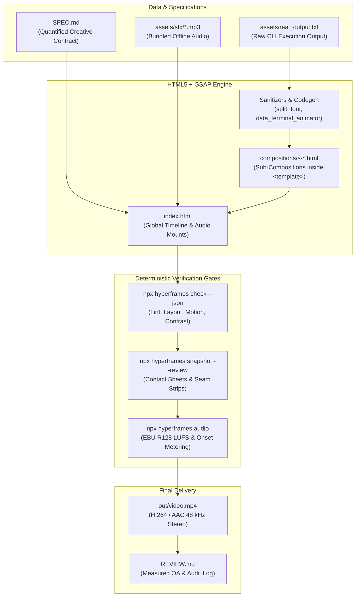

# Motion Video Engineering Runbook: HyperFrames & GSAP Pipeline

This document codifies the technical invariants, animation architectures, and production workflows learned during the development of the SuperGhidra launch video (`E:\02_Projects\superghidra-launch\film\out\superghidra-tiktok.mp4`, Claude session `cf067101-7ae1-43bd-b0d2-84405d4a8fbe`).

---

## 1. System Architecture & Environment

HyperFrames renders HTML/CSS and GSAP timelines into deterministic MP4 video by driving headless Chromium frame-by-frame and muxing audio with FFmpeg.



### Workstation Prerequisites (Windows 11)
- **Node.js:** Node 22+ (verified on v24.21.0).
- **FFmpeg 9.0.1:** Dedicated binary path at `E:\03_Devops\hermes\tools\ffmpeg-9.0.1-win32-x64\bin`. Must be prepended to `$env:Path` per session:
  ```powershell
  $env:Path = "E:\03_Devops\hermes\tools\ffmpeg-9.0.1-win32-x64\bin;" + $env:Path
  ```
- **CLI Invariant:** Pinned package `npx hyperframes@0.8.195`.
- **Telemetry Suppression:** HeyGen tracking must be denied on every execution:
  ```powershell
  $env:DO_NOT_TRACK = "1"
  $env:HYPERFRAMES_NO_TELEMETRY = "1"
  $env:HYPERFRAMES_SKIP_SKILLS = "1"
  ```

---

## 2. The 8 Hard-Won Technical Invariants

### Invariant 1: Font Loading Longhand Requirement
- **Defect:** Headless Chromium fails to match and load custom web fonts (`Archivo Black`, `JetBrains Mono`, `Inter`) when declared using the CSS `font:` shorthand property (e.g. `font: 400 34px/1.4 'JetBrains Mono', monospace;`). The browser falls back to default serif/sans-serif (`Times New Roman` or `Helvetica`), breaking layout dimensions and column alignment.
- **Rule:** Write explicit CSS longhand properties exclusively:
  ```css
  /* PASS */
  font-family: 'JetBrains Mono', monospace;
  font-weight: 400;
  font-size: 34px;
  line-height: 1.4;
  ```
- **Automated Fixer:** Run `node scripts/font_longhand_sanitizer.mjs --dir compositions`.

### Invariant 2: Code Terminal Ligature Neutralization
- **Defect:** Modern developer fonts include OpenType standard ligatures and contextual alternates that combine discrete ASCII character sequences:
  - `->` collapses to `→` (`\u2192`)
  - `<-` collapses to `←` (`\u2190`)
  - `!=` collapses to `≠` (`\u2260`)
  - `==` collapses to a connected double bar
  In terminal animations, reverse engineering output, and disassembly traces, this distorts authentic tool output and breaks character column grids.
- **Rule:** Disable ligatures on all code and terminal containers:
  ```css
  #terminal-body, pre, code, .ln {
    font-variant-ligatures: none;
    font-feature-settings: "liga" 0, "calt" 0;
  }
  ```

### Invariant 3: GSAP Transform-Only Motion
- **Defect:** Animating CSS layout box properties (`top`, `left`, `width`, `height`, `margin`, `padding`) forces browser layout reflows on every rendered frame, causes frame stutter during headless rasterization, and fails the automated linter gate with error:
  `gsap_non_transform_motion: animate transforms (x, y, scale) instead of layout properties`.
- **Rule:** Restrict GSAP animations to hardware-accelerated transform properties:
  - Position changes: `x` and `y`.
  - Expanding elements (progress bars, terminal frames): `scaleX` or `scaleY` with `transform-origin: left center;`, or `clipPath: "inset(...)"`.
  - Revealing content: `clipPath` wipes or `opacity`.
- **State Machine Rule:** Always invoke `gsap.fromTo()`. Never use `gsap.from()` because seeking or scrubbing backwards can leave DOM nodes stuck in uninitialized intermediate states.

### Invariant 4: Audio Onset Lead-In Compensation
- **Defect:** Audio sound effect assets (.mp3) often have silent buffers or gradual pre-attack transient swells before their perceptual impact:
  - `error.mp3`: Contains ~600 ms of pre-rumble before the abrasive buzzer sound.
  - `ping.mp3`: Contains ~320 ms of ambient room rise before the bell chime.
  - `impact.mp3`: Contains ~30 ms of pre-strike sub-bass.
  If an audio element's `data-start` is set to the exact visual cut timestamp ($T_{\text{visual}}$), the audio impact lands visibly late.
- **Rule:** Calculate audio start time using negative offset:
  $$T_{\text{audio}} = T_{\text{visual}} - T_{\text{lead\_in}}$$
  *Example:* For an error buzzer landing on Beat 2 at 3.83 s:
  $$\text{data-start} = 3.83\text{ s} - 0.60\text{ s} = 3.23\text{ s}$$
- **Tag Contract:** Every `<audio>` element MUST possess a unique `id` attribute (e.g. `id="sfx-error"`). Tags lacking an `id` are discarded by the HyperFrames audio mix engine.

### Invariant 5: Vertical Safe Zones (TikTok, Reels, Shorts)
For 1080 × 1920 px (9:16 portrait) canvas at 30 fps:
- **Top Exclusion Zone (`y < 168 px`):** System status bar, search bar, Following/For You tabs.
- **Bottom Exclusion Zone (`y > 1330 px`):** Creator handle, multi-line caption, audio ticker, action pills, platform navigation bar. Only solid background color or non-critical texture is permitted below 1330 px.
- **Right Rail Exclusion Zone (`x > 940 px`):** Profile avatar, like count, comment count, bookmark, share buttons.
- **Action Safe Rectangle:** `x: [0, 940 px]`, `y: [168, 1330 px]`. All headlines, terminals, diagram nodes, and CTAs must remain inside this area.
- **Minimum Font Floor:** 28 px. Text rendered under 28 px becomes illegible on standard phone viewports.

### Invariant 6: Frame 0 Hook Rule
- **Principle:** On vertical platforms, Frame 0 functions as the instant thumbnail preview. If Frame 0 is black, fades up from opacity 0, or shows a static logo splash, viewers swipe away within 200 ms.
- **Rule:** Frame 0 must be fully rendered with high-contrast copy presenting an immediate problem, benchmark disparity, or visceral failure state.
  *Example:* SuperGhidra's launch opens on Frame 0 with `UP TO 15s of JVM startup. Every run.` in 400 px Archivo Black against `#FF4B1F` orange.

### Invariant 7: Data-Driven Stdout-to-Animation Pipeline
- **Principle:** Never invent or hand-craft terminal output. Hand-typed text lacks authentic tool formatting, memory addresses, and return codes.
- **Pipeline:**
  1. Capture stdout via `python scripts/capture_real_stdout.py`.
  2. Parse stdout into character spans using `node scripts/data_terminal_animator.mjs`.
  3. Animate typing with GSAP:
     ```javascript
     tl.fromTo("#cmd .c", { opacity: 0 }, { opacity: 1, duration: 0.001, stagger: 0.018, ease: "none" });
     ```
  4. Scoped wrapping: Apply `white-space: pre-wrap;` to `.ln` elements only, never to `#terminal-body`.
  5. Fluorescent marker swipe: Highlight key wins (`755`, `391`) by animating `background-size: 100% 100%` on linear-gradient spans.

### Invariant 8: Banned Visual Defaults
To maintain an authentic engineering aesthetic, eliminate generic marketing tropes:
- No dark void with floating neon particles or glow/bloom filters.
- No glassmorphic cards with multi-colored radial gradient borders.
- No three-cards-in-a-row KPI layout.
- No 3D device clay mockups (floating iPhones/MacBooks).
- No human faces, AI avatars, or synthesized speech unless requested.
- Visual Grounding: High-contrast flat color-block poster grounds (`#FF4B1F` orange, `#B8F433` acid green, `#FFFFFF` white, `#0A0A0A` obsidian ink) contrasted with one authentic product surface.

---

## 3. Project File Structure Contract

A standard HyperFrames motion video project is organized as follows:

```
project/
├── index.html                   # Root composition (mounts scene hosts & audio tracks)
├── SPEC.md                      # Quantified creative contract (frame-by-frame plan)
├── REVIEW.md                    # Verification report (measured loudness, frames, gates)
├── hyperframes.json             # Engine configuration & resolution metadata
├── package.json                 # Pinned dependencies (hyperframes@0.8.195, gsap@3.14.2)
├── assets/
│   ├── real_output.txt          # Raw captured tool execution stdout
│   └── sfx/                     # Sound effects (whoosh, error, typing, pop, ping, impact)
├── compositions/
│   ├── s-hook.html              # S1: Frame 0 tension & problem
│   ├── s-proof.html             # S2: Authenticated terminal execution
│   ├── s-how.html               # S3: Architecture data flow (READS/WRITES)
│   ├── s-agents.html            # S4: Slot-machine ecosystem integration
│   └── s-end.html               # S5: Clean CTA and install command
└── out/
    └── video.mp4                # Final rendered H.264 / AAC MP4 video
```

---

## 4. Production Workflow & CLI Reference

### Step 1: Capture Raw Execution Output
```powershell
python scripts/capture_real_stdout.py -o assets/real_output.txt
```

### Step 2: Author Quantified `SPEC.md`
Use `templates/SPEC_TEMPLATE.md`. Define every shot by frame range and target timecode.

### Step 3: Generate Terminal Composition
```powershell
node scripts/data_terminal_animator.mjs --input assets/real_output.txt --output compositions/s-proof.html
```

### Step 4: Sanitize Stylesheets
Ensure no `font:` shorthands exist in any composition file:
```powershell
node scripts/font_longhand_sanitizer.mjs --dir compositions
```

### Step 5: Align Audio Onsets
Measure sound effect files and compute lead-in offsets:
```powershell
python scripts/audio_onset_aligner.py --check-html index.html --assets-dir assets/sfx
```

### Step 6: Automated Verification Gates
Execute the three QA gates:
```powershell
# Prepend FFmpeg
$env:Path = "E:\03_Devops\hermes\tools\ffmpeg-9.0.1-win32-x64\bin;" + $env:Path

# Telemetry suppression
$env:DO_NOT_TRACK = "1"; $env:HYPERFRAMES_NO_TELEMETRY = "1"; $env:HYPERFRAMES_SKIP_SKILLS = "1"

# Gate 1: Syntax, lint, runtime, contrast, layout checks
npx hyperframes check --json

# Gate 2: Contact sheets and seam strip review
npx hyperframes snapshot --review

# Gate 3: Interactive local preview server
npx hyperframes preview --background
```

### Step 7: Final Deterministic Render
```powershell
npx hyperframes render --quality looks --output out/superghidra-tiktok.mp4
```

### Step 8: Audio & Conformance Verification
Validate duration, stream presence, and EBU R128 loudness metrics:
```powershell
# Measure integrated loudness and true peak
npx hyperframes audio

# Confirm exact duration match with root data-duration
ffprobe -v error -show_entries format=duration -of default=noprint_wrappers=1:nokey=1 out/superghidra-tiktok.mp4
```

---

## 5. Measured Production Metrics Reference

| Metric | Target Standard | Measured Value (`superghidra-tiktok.mp4`) | Conformance Status |
| :--- | :--- | :--- | :--- |
| **Resolution** | 1080 × 1920 px (9:16) | 1080 × 1920 px | PASS |
| **Framerate** | 30.0 fps | 30.0 fps | PASS |
| **Exact Duration** | 30.000 s (900 frames) | 30.000 s | PASS |
| **Video Codec** | H.264 (High Profile) | H.264 | PASS |
| **Audio Stream** | AAC Stereo, 48 kHz | AAC Stereo, 48 kHz | PASS |
| **Integrated Loudness** | -11.0 to -16.0 LUFS | -11.1 LUFS | PASS (SFX-only mix) |
| **True Peak** | < -1.0 dBTP | -1.7 dBTP | PASS |
| **Clipped Samples** | 0 | 0 | PASS |
| **Automated Lint Errors**| 0 errors | 0 errors | PASS |
| **Safe Zone Invariant** | Inside y: 168-1330 px | All text & terminal within box | PASS |

---

## 6. Installed Skills Inventory

The following skills are installed and synchronized across both Antigravity's global plugin store and the active repository:

1. **`motion-video-making`:** Master motion graphics workflow, scripts, templates, and invariants.
   - Global: `C:\Users\X\.gemini\config\plugins\antigravity-lab\skills\motion-video-making\`
   - Local: `E:\02_Projects\SuperGhidra\.agents\skills\motion-video-making\`
2. **`hyperframes`:** Core engine contract, composition rules, format references.
3. **`hyperframes-cli`:** CLI task router (`check`, `render`, `snapshot`, `timeline`, `audio`).
4. **`hyperframes-registry`:** Component catalog for transitions, kinetic typography, and cards.
5. **`media-use`:** Asset acquisition, audio mixing, and background treatment.
6. **`figma`:** Motion reconstruction from design tokens and frame states.
7. **`remotion-to-hyperframes`:** React/Remotion migration and parity testing harness.
8. **`slideshow`:** Presenter-mode live decks and standalone presentation harnesses.
